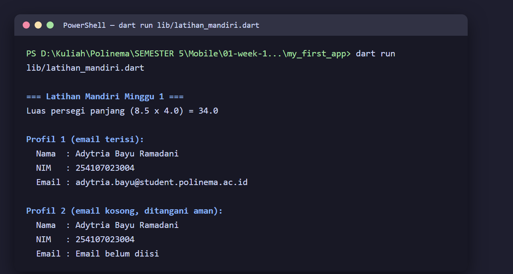
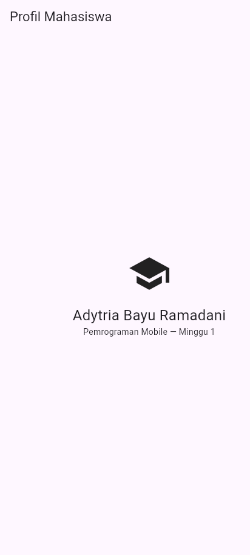
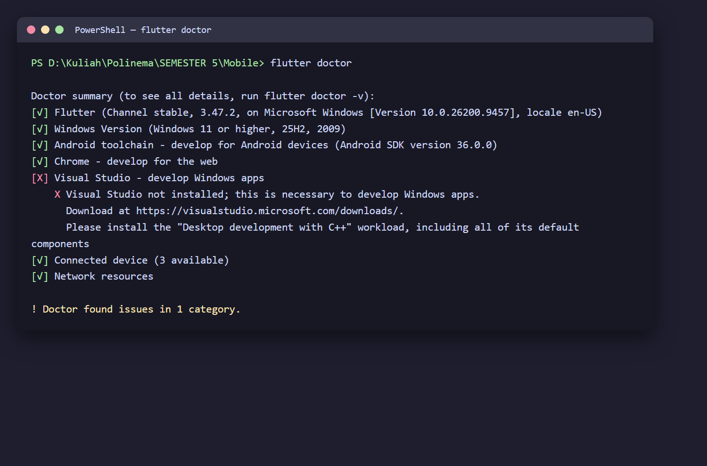
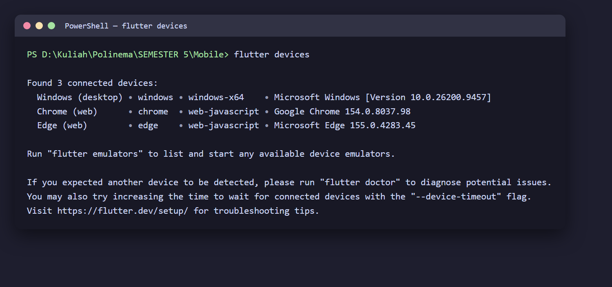
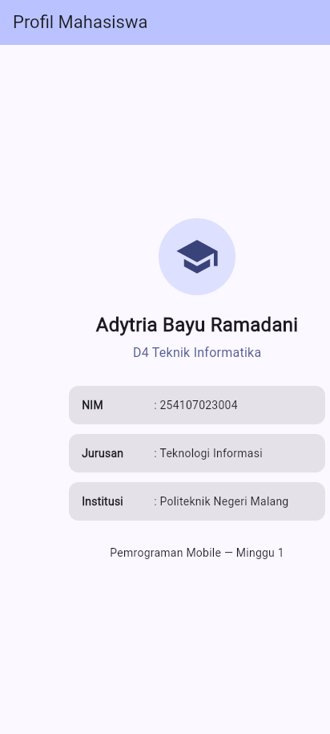
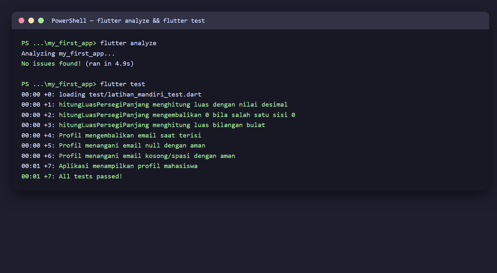

# 01 Week 1 — Mobile Development Ecosystem & Flutter Refresh

Dokumentasi hasil pengerjaan Praktikum Pemrograman Mobile Minggu ke-1. Dokumentasi ini berisi screenshot, penjelasan, dan jawaban pertanyaan dari praktikum.

**Identitas:** Adytria Bayu Ramadani · NIM 254107023004 · D4 Teknik Informatika · Jurusan Teknologi Informasi · Politeknik Negeri Malang

## Tujuan Pembelajaran

- Menjelaskan evolusi pengembangan mobile (native, hybrid, cross-platform).
- Menjelaskan arsitektur Flutter, peran Dart, struktur proyek, dan widget tree.
- Mengulang dasar Dart: variabel, tipe data, fungsi, class, dan null safety.
- Menyiapkan Flutter, Android SDK, emulator/perangkat, lalu menjalankan aplikasi pertama.
- Mengubah UI awal Flutter dan menyimpannya pada repository Git pribadi.

## Struktur Folder

```
01-week-1-mobile-development-ecosystem-flutter-refresh/
├── my_first_app/
│   ├── lib/
│   │   ├── main.dart              # Aplikasi Profil Mahasiswa (tugas)
│   │   ├── codelab_profile.dart   # UI versi codelab (praktikum)
│   │   └── latihan_mandiri.dart   # Latihan mandiri Dart
│   └── test/
│       ├── latihan_mandiri_test.dart  # Unit test fungsi & kelas Profil
│       └── widget_test.dart           # Widget test aplikasi profil
├── screenshots/
└── README.md
```

## Latihan Mandiri

1. Buat fungsi `hitungLuasPersegiPanjang(double panjang, double lebar)` yang mengembalikan luas.
2. Buat kelas `Profil` dengan properti `nama`, `nim`, dan `email` (boleh null/empty).
3. Panggil keduanya dari `main()` dan tangani kondisi email kosong dengan aman.

Implementasi pada `lib/latihan_mandiri.dart`. Hasil eksekusi `dart run lib/latihan_mandiri.dart`:



Penanganan email kosong menggunakan method `emailAtauDefault()` yang memakai null-aware dan `trim()` sehingga email `null` maupun berisi spasi tetap aman:

```dart
String emailAtauDefault() {
  final emailBersih = email?.trim() ?? '';
  if (emailBersih.isEmpty) {
    return 'Email belum diisi';
  }
  return emailBersih;
}
```

## Praktikum

Mengganti UI default `lib/main.dart` dengan aplikasi profil sederhana sesuai codelab, lalu menjalankannya:



## Checklist Verifikasi

- `flutter doctor` tidak memiliki masalah yang menghambat target Android.
  
- `flutter devices` mendeteksi emulator/perangkat fisik.
  
- Aplikasi berjalan dan UI default telah diganti dengan profil sederhana.
  
- Dapat menjelaskan perbedaan hot reload dan hot restart.

Penjelasan singkat:

```
- Hot reload: memuat ulang hanya perubahan pada kode ke aplikasi yang sedang berjalan tanpa mengulang aplikasi dari awal. State yang sudah ada tidak hilang.
- Hot restart: memulai ulang aplikasi sepenuhnya dan memuat ulang seluruh kode; state di-reset. Efektif dipakai bila perubahan memerlukan inisialisasi ulang.
```

- Repository remote berisi source code, README, screenshot, dan riwayat commit.

---

## Mini Assignment

Buat aplikasi Profil Mahasiswa berdasarkan praktikum. Tambahkan NIM dan satu informasi tambahan menggunakan widget dasar.

Aplikasi menampilkan nama, program studi, NIM, jurusan, institusi, dan satu informasi tambahan menggunakan widget dasar (`Column`, `Row`, `CircleAvatar`, `Container`, `Text`).



---

## Testing

Verifikasi kualitas kode dengan static analysis dan test otomatis:

```bash
flutter analyze   # No issues found!
flutter test      # 7 test lulus
```



Test yang dibuat:

| Test | Jenis | Cakupan |
|---|---|---|
| hitungLuasPersegiPanjang (3 kasus) | Unit | nilai desimal, sisi nol, bilangan bulat |
| Profil (3 kasus) | Unit | email terisi, email null, email kosong/spasi |
| Aplikasi menampilkan profil | Widget | teks nama, NIM, prodi, institusi tampil |

---

## Kendala Setup

Emulator Android bawaan gagal dijalankan karena ruang disk C: tidak mencukupi untuk partisi `userdata` (butuh ±7.4 GB, tersedia ±5.2 GB). Solusi: praktikum dijalankan pada target **web (Edge/Chrome)** yang jauh lebih ringan, sementara `flutter doctor` sudah bersih untuk target Android (Android SDK 36.0.0, lisensi diterima). Sisa peringatan hanya Visual Studio untuk target desktop Windows yang tidak diperlukan pada praktikum ini.

---

## Refleksi

1. Kapan native lebih tepat dipilih daripada cross-platform?

   Jawab: Native lebih tepat ketika aplikasi membutuhkan performa tinggi, akses mendalam ke fitur perangkat (kamera, sensor, Bluetooth), dan integrasi API platform terbaru. Cross-platform (Flutter) lebih cocok ketika ingin satu basis kode untuk Android dan iOS dengan waktu dan biaya pengembangan lebih efisien.

2. Bagaimana perubahan state berhubungan dengan widget tree dan UI deklaratif?

   Jawab: Pada UI deklaratif, tampilan adalah fungsi dari state. Ketika state berubah, Flutter membangun ulang (rebuild) bagian widget tree yang terpengaruh sehingga UI otomatis menyesuaikan state terbaru — tanpa mengubah elemen satu per satu secara manual.

3. Mengapa commit kecil dengan pesan jelas bermanfaat bagi pekerjaan tim dan portfolio?

   Jawab: Commit kecil dan pesan jelas memudahkan memahami, melacak, dan me-review perubahan. Bila terjadi kesalahan, riwayat dapat ditelusuri dan dikembalikan. Untuk portfolio, riwayat commit yang rapi menunjukkan kebiasaan kerja yang terstruktur dan profesional.

## Cara Menjalankan

```bash
cd my_first_app
flutter pub get
flutter run -d edge        # atau -d chrome / perangkat Android
dart run lib/latihan_mandiri.dart   # menjalankan latihan mandiri
flutter test               # menjalankan test
```
