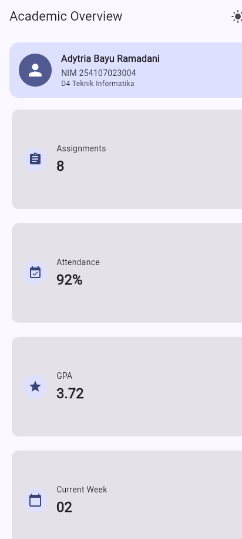
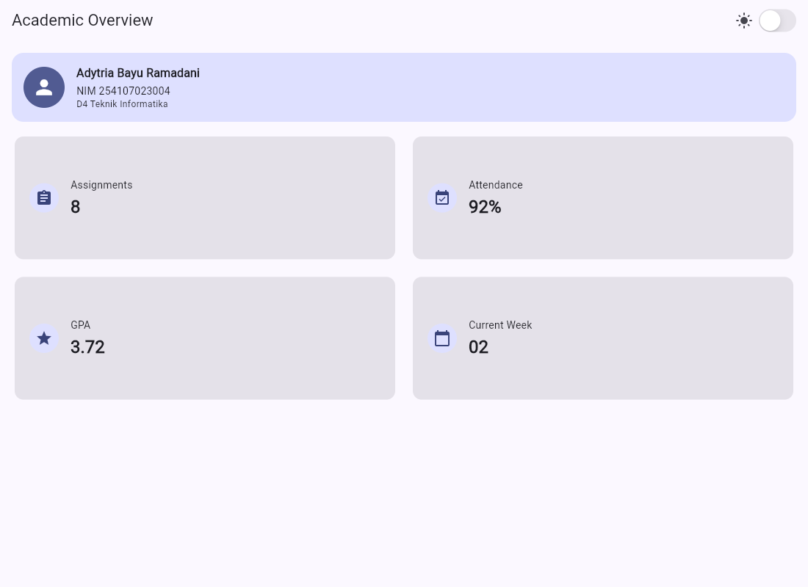
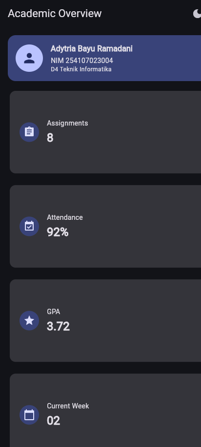
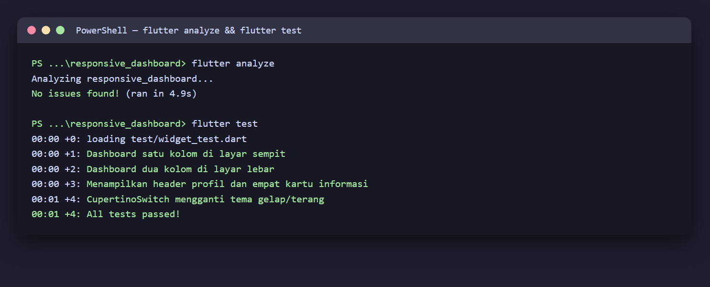

# 02 Week 2 — Declarative UI & Responsive Design

Dokumentasi hasil pengerjaan Praktikum Pemrograman Mobile Minggu ke-2. Dokumentasi ini berisi screenshot, penjelasan, dan jawaban pertanyaan dari praktikum.

**Identitas:** Adytria Bayu Ramadani · NIM 254107023004 · D4 Teknik Informatika · Jurusan Teknologi Informasi · Politeknik Negeri Malang

## Tujuan Pembelajaran

- Menjelaskan prinsip declarative UI dan hubungan widget, konfigurasi, serta state.
- Menggunakan `StatelessWidget`, `StatefulWidget`, `Container`, `Row`, `Column`, dan `Expanded`.
- Membedakan komponen Material 3 dan Cupertino.
- Membangun layout responsif untuk ukuran layar mobile dan tablet.
- Menerapkan theme, dark mode, styling, dan aksesibilitas dasar.

## Struktur Folder

```
02-week-2-declarative-ui-responsive-design/
├── responsive_dashboard/
│   ├── lib/
│   │   ├── main.dart                 # DashboardApp + toggle tema (StatefulWidget)
│   │   ├── data.dart                 # data kartu + kWideBreakpoint
│   │   ├── pages/dashboard_page.dart # layout responsif (LayoutBuilder)
│   │   └── widgets/
│   │       ├── info_card.dart        # kartu reusable + Semantics
│   │       └── profile_header.dart   # header profil + Semantics
│   └── test/widget_test.dart         # 4 widget test responsif & tema
├── screenshots/
└── README.md
```

## Praktikum

Target: dashboard **Academic Overview** yang menampilkan **satu kolom** pada layar sempit dan **dua kolom** pada layar lebar, dengan tema terang dan gelap yang konsisten.



## Tugas Utama — Academic Overview

- Header profil dan empat kartu informasi (Assignments, Attendance, GPA, Current Week).
- Menggunakan `Row`, `Column`, `Expanded`, dan `Container`.
- Satu kolom pada layar sempit, dua kolom pada layar lebar.
- Light theme dan dark theme dengan toggle `CupertinoSwitch`.
- Label aksesibilitas (`Semantics`) untuk profil dan tiap kartu.

**Layar sempit (1 kolom):**


**Layar lebar (2 kolom):**



**Dark mode:**



### Penjelasan Responsif

Breakpoint didefinisikan satu kali sebagai konstanta `kWideBreakpoint = 700`:

```dart
body: LayoutBuilder(
  builder: (context, constraints) {
    final isWide = constraints.maxWidth >= kWideBreakpoint;
    final columns = isWide ? 2 : 1;
    ...
  },
),
```

`LayoutBuilder` membaca lebar yang tersedia lalu menentukan jumlah kolom, sehingga layout menyesuaikan ukuran layar tanpa ukuran piksel tetap.

### Material vs Cupertino

`CupertinoSwitch` dari `package:flutter/cupertino.dart` dipakai pada `AppBar` untuk mengganti tema. Berbeda dengan `Switch` Material, `CupertinoSwitch` mengikuti tampilan khas iOS. Alternatifnya `Switch.adaptive` yang otomatis menampilkan gaya Cupertino di iOS.

## Checklist Verifikasi

- `flutter analyze` tidak menghasilkan error.
- `flutter test` lulus semua widget test responsif.
- Aplikasi dapat dijalankan pada ukuran layar sempit dan lebar.
- Dark mode memiliki kontras dan teks yang terbaca.
- Struktur widget dapat dijelaskan saat code review.
- Screenshot, folder `test/`, dan README sudah tersimpan pada folder tugas Week 2.

## Testing

```bash
flutter analyze   # No issues found!
flutter test      # 4 test lulus
```



| Test | Cakupan |
|---|---|
| Dashboard satu kolom di layar sempit | lebar kartu < 700 px pada 400 px |
| Dashboard dua kolom di layar lebar | lebar kartu > 500 px pada 1200 px |
| Menampilkan header profil dan empat kartu | teks nama, NIM, 4 kartu |
| CupertinoSwitch mengganti tema | ikon light → dark setelah tap |

## Refactoring yang Dilakukan

1. Kartu informasi diekstrak menjadi widget reusable `InfoCard` (menerima `title`, `value`, `icon`, `semanticLabel`).
2. Warna dan ukuran memakai `Theme.of(context)` sehingga otomatis mengikuti tema terang/gelap.
3. Breakpoint dipusatkan pada konstanta `kWideBreakpoint`.

---

## Kendala

Emulator Android tidak dapat dijalankan karena keterbatasan ruang disk, sehingga aplikasi diuji pada target **web (Edge)** untuk pengambilan screenshot. Widget test tetap dijalankan tanpa emulator (headless), jadi verifikasi responsif tetap valid.

---

## Refleksi

1. Apa perbedaan cara berpikir imperative dan declarative saat membangun UI?

   Jawab: Imperative mengubah UI langkah demi langkah secara manual (mis. mengatur properti setiap elemen). Declarative mendeskripsikan UI sebagai fungsi dari state; ketika state berubah, framework membangun ulang bagian yang relevan sehingga developer cukup fokus pada data dan tampilan.

2. Kapan `Expanded` membantu dan kapan penggunaannya justru menghasilkan layout error?

   Jawab: `Expanded` membantu membagi ruang tersisa dalam `Row`/`Column` secara proporsional, misalnya agar teks panjang mengisi sisa lebar. Ia menyebabkan error bila dipakai di dalam parent yang tidak memberi batas ruang (unbounded), misalnya `Row` di dalam `Column` tanpa `Expanded` pembungkus, atau saat anak memiliki lebar tak terbatas.

3. Bagaimana breakpoint dan theme memengaruhi pengalaman pengguna?

   Jawab: Breakpoint menentukan jumlah kolom sehingga konten tetap nyaman dibaca di ponsel maupun tablet. Theme (light/dark) meningkatkan keterbacaan dan kenyamanan mata pada kondisi pencahayaan berbeda, serta menjaga kontras dan aksesibilitas.

## Cara Menjalankan

```bash
cd responsive_dashboard
flutter pub get
flutter run -d edge     # atau -d chrome / perangkat Android
flutter test
```
