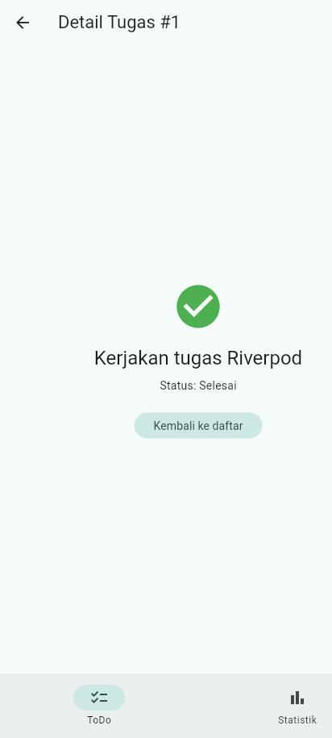
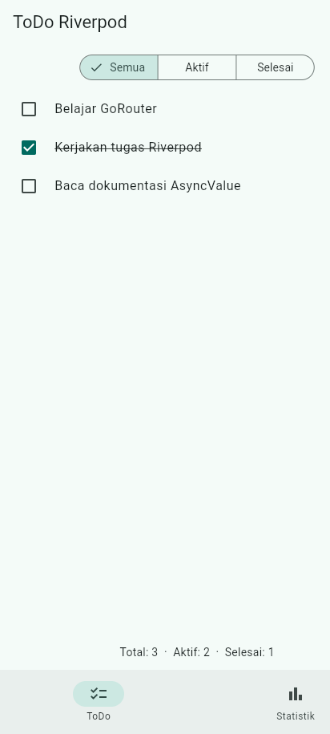
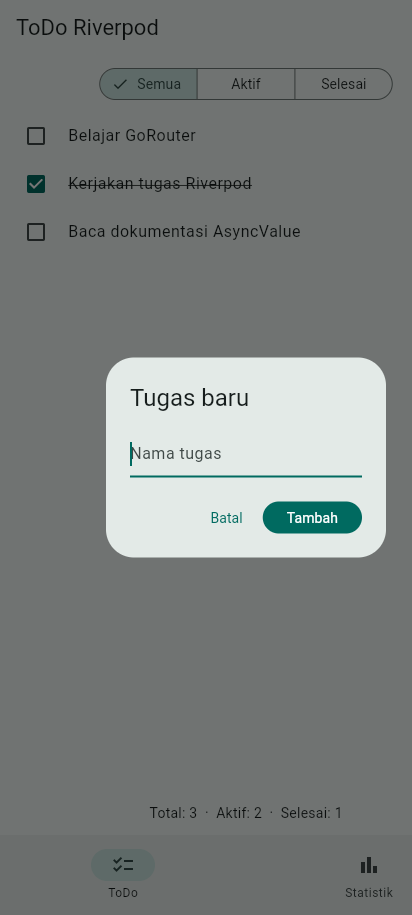
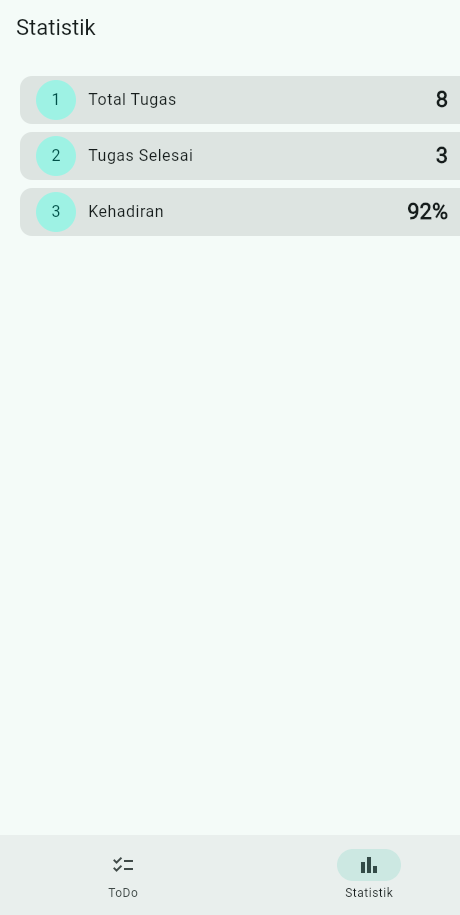
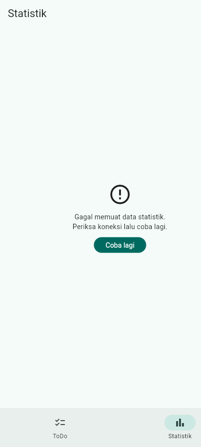
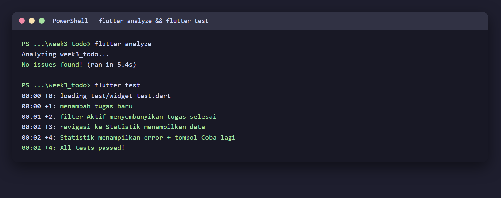

# 03 Week 3 — Navigation & State Management

Dokumentasi hasil pengerjaan Praktikum Pemrograman Mobile Minggu ke-3. Dokumentasi ini berisi screenshot, penjelasan, dan jawaban pertanyaan dari praktikum.

**Identitas:** Adytria Bayu Ramadani · NIM 254107023004 · D4 Teknik Informatika · Jurusan Teknologi Informasi · Politeknik Negeri Malang

## Tujuan Pembelajaran

- Menjelaskan konsep navigasi, route, dan perbedaan Navigator 1.0 dengan GoRouter.
- Menerapkan navigasi multi-page dengan GoRouter (passing argument, deep link sederhana).
- Menjelaskan cara kerja Riverpod (`Provider`, `ConsumerWidget`, `Notifier`).
- Menggunakan `AsyncValue` untuk menangani state loading, error, dan success.
- Membangun aplikasi ToDo dengan navigasi + Riverpod dan widget test sederhana.

## Struktur Folder

```
03-week-3-navigation-state-management/
├── week3_todo/
│   ├── lib/
│   │   ├── main.dart                     # ProviderScope + MaterialApp.router
│   │   ├── router.dart                   # GoRouter + StatefulShellRoute + NavigationBar
│   │   ├── pages/
│   │   │   ├── todo_page.dart            # daftar tugas + filter + tambah
│   │   │   ├── stats_page.dart           # AsyncValue: loading/error/success
│   │   │   └── detail_page.dart          # rute detail /detail/:index
│   │   ├── providers/
│   │   │   ├── todo_provider.dart        # Notifier + provider turunan (filter/stats)
│   │   │   └── stats_provider.dart       # AsyncNotifier + AsyncValue
│   │   └── widgets/todo_tile.dart        # baris tugas reusable
│   ├── test/widget_test.dart             # 4 widget test
│   └── docs/ai-challenge.md              # prompt AI + verifikasi
├── screenshots/
└── README.md
```

## Praktikum 1 — Multi-page dengan GoRouter

Router deklaratif dengan `GoRoute`, path parameter `/detail/:index`, dan deep
link sederhana. Halaman detail dapat diakses langsung tanpa melewati Home:



## Praktikum 2 — Aplikasi ToDo dengan Riverpod

State daftar tugas dikelola `TodoListNotifier` (immutable). UI `ConsumerWidget`
membaca provider dan memanggil method notifier lewat `ref.read(...notifier)`.
Filter (Semua/Aktif/Selesai) dihitung oleh provider turunan.



Dialog tambah tugas:



## Praktikum 3 — Uji Ketiga State (AsyncValue)

`statsProvider` (`AsyncNotifier`) mensimulasikan pengambilan data (delay 2 detik).
UI menangani **loading**, **error** (pesan + tombol Coba lagi), dan **success**:

**Success:**



**Error + tombol Coba lagi:**



`ref.invalidate(statsProvider)` pada tombol "Coba lagi" menjalankan ulang provider.

## Checklist Verifikasi

- Navigasi GoRouter bekerja: pindah halaman, back, dan akses path detail langsung.
- `ProviderScope` membungkus root aplikasi; state ToDo bertahan saat berpindah halaman.
- UI `AsyncValue` menangani loading, error, dan success, bukan hanya success.
- `flutter analyze` tanpa issue dan semua test lulus.
- Hasil AI diverifikasi dan didokumentasikan pada folder `docs/`.

## Testing

```bash
flutter analyze   # No issues found!
flutter test      # 4 test lulus
```



| Test | Cakupan |
|---|---|
| menambah tugas baru | dialog + state bertambah |
| filter Aktif menyembunyikan tugas selesai | provider turunan filter |
| navigasi ke Statistik menampilkan data | GoRouter + AsyncValue success (provider palsu) |
| Statistik menampilkan error + tombol Coba lagi | AsyncValue error (provider palsu) |

## Refactoring yang Dilakukan

1. Baris tugas diekstrak menjadi widget `TodoTile` tersendiri.
2. Logika filter diekstrak menjadi `Provider` turunan (`filteredTodosProvider`) yang membaca `todoListProvider`.
3. Aplikasi diintegrasikan dengan GoRouter: `/` untuk daftar dan `/stats` untuk statistik, dengan `NavigationBar` untuk berpindah (`StatefulShellRoute`).

## AI Challenge

Prompt, output AI, perbaikan manual, dan checklist verifikasi didokumentasikan pada [`week3_todo/docs/ai-challenge.md`](./week3_todo/docs/ai-challenge.md). Poin penting: error Riverpod 3 auto-retry dinonaktifkan (`retry: (_, _) => null`), pesan error teknis diganti pesan ramah, dan ditambahkan override provider palsu untuk test deterministik.

---

## Kendala

Emulator Android tidak dijalankan karena keterbatasan ruang disk, sehingga screenshot diambil pada target **web (Edge)**. Widget test berjalan headless tanpa emulator. Untuk screenshot state success/error yang deterministik, ditambahkan `dart-define` (`FORCE_SUCCESS`/`FORCE_ERROR`) dan seed data (`SEED_TODOS`).

---

## Refleksi

1. Kapan `setState` masih cukup, dan kapan state harus naik ke Riverpod?

   Jawab: `setState` cukup untuk state lokal satu widget yang tidak dibagi (mis. toggle tema di dalam satu halaman). State harus naik ke Riverpod ketika dibagi antar banyak halaman/widget, perlu diuji tanpa UI, atau harus tetap hidup saat widget tidak tampil.

2. Apa perbedaan `context.go` dan `context.push`, dan kapan masing-masing tepat?

   Jawab: `context.go` mengganti stack navigasi (lokasi tujuan menjadi satu-satunya halaman aktif), cocok untuk berpindah tab/halaman utama. `context.push` menumpuk route baru di atas stack sehingga tombol back kembali ke halaman sebelumnya, cocok untuk halaman detail.

3. Bagaimana `AsyncValue` mencegah bug dibanding tiga boolean terpisah?

   Jawab: `AsyncValue` memodelkan loading, error, dan data sebagai satu tipe sehingga mustahil berada di kondisi tidak konsisten (mis. `isLoading` dan `hasError` keduanya true). `when()` memaksa menangani ketiga kondisi, menghindari lupa menangani error yang menyebabkan layar putih.

4. Bagian mana dari hasil AI yang Anda perbaiki, dan mengapa?

   Jawab: Menonaktifkan retry otomatis Riverpod 3 agar error final dan test tidak menggantung; mengganti pesan error teknis menjadi pesan ramah pengguna; serta menambahkan override provider palsu agar test tidak menunggu delay 2 detik. Detail ada di `docs/ai-challenge.md`.

## Cara Menjalankan

```bash
cd week3_todo
flutter pub get
flutter run -d edge     # atau -d chrome / perangkat Android
flutter test
```
