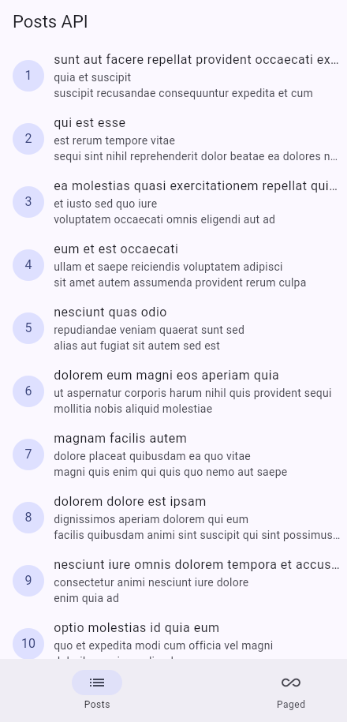
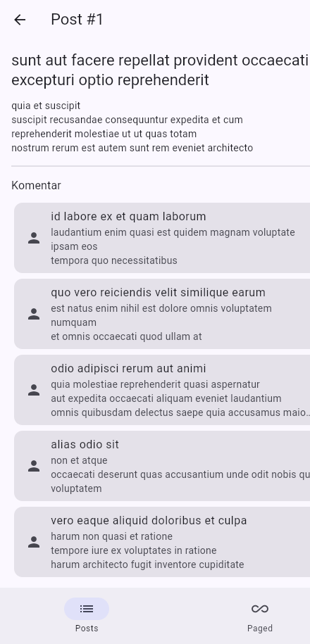
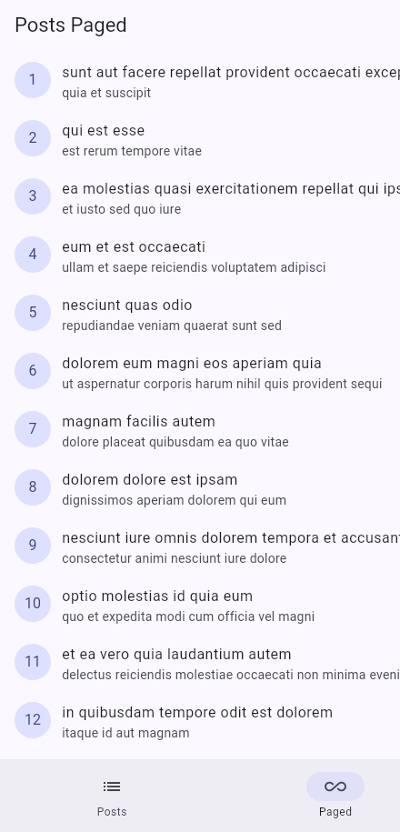
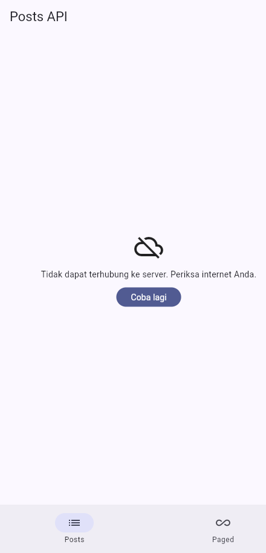
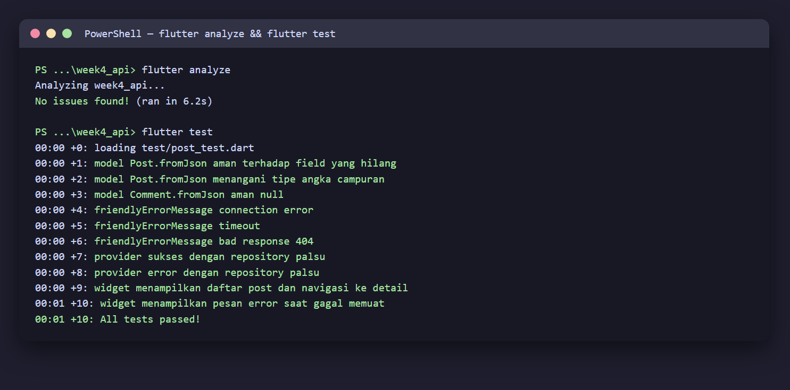

# 04 Week 4 — Networking & REST API

Dokumentasi hasil pengerjaan Praktikum Pemrograman Mobile Minggu ke-4. Dokumentasi ini berisi screenshot, penjelasan, dan jawaban pertanyaan dari praktikum.

**Identitas:** Adytria Bayu Ramadani · NIM 254107023004 · D4 Teknik Informatika · Jurusan Teknologi Informasi · Politeknik Negeri Malang

## Tujuan Pembelajaran

- Menjelaskan konsep HTTP, REST API, dan JSON.
- Memetakan JSON ke model Dart (serialization) dengan aman null.
- Menerapkan repository pattern dasar sehingga UI tidak memanggil API langsung.
- Mengonfigurasi Dio (base URL, timeout, interceptor) dan menangani error jaringan.
- Menampilkan state loading, error, empty, dan success dengan `AsyncValue` + Riverpod.
- Menerapkan pagination dasar (infinite scroll).

## Struktur Folder

```
04-week-4-networking-rest-api/
├── week4_api/
│   ├── lib/
│   │   ├── main.dart                     # ProviderScope + MaterialApp.router
│   │   ├── router.dart                   # GoRouter (Posts / Paged / detail)
│   │   ├── data/
│   │   │   ├── api_client.dart           # Dio terpusat
│   │   │   ├── network_errors.dart       # friendlyErrorMessage
│   │   │   ├── providers.dart            # AsyncNotifier + FutureProvider
│   │   │   ├── paged_posts.dart          # state pagination + guard
│   │   │   ├── models/{post,comment}.dart
│   │   │   └── repositories/post_repository.dart
│   │   └── pages/
│   │       ├── post_list_page.dart       # 4 state + PostTile
│   │       ├── post_detail_page.dart     # /post/:id + komentar
│   │       └── paged_post_page.dart      # infinite scroll
│   ├── test/post_test.dart               # 10 test
│   └── docs/ai-challenge.md
├── screenshots/
└── README.md
```

## Praktikum — Daftar Data dari REST API

Data diambil dari JSONPlaceholder `/posts` melalui `PostRepository` → Dio,
dibaca UI lewat `postListProvider` (`AsyncNotifier`). Empat state ditangani:
loading, error (+ Coba lagi), empty, dan success.



## Detail Post `/post/:id`

Rute detail menampilkan `title`, `body`, dan daftar komentar (`/comments?postId=`):



## Pagination — Infinite Scroll

Halaman berikutnya dimuat saat pengguna mendekati ujung list (200 px sebelum
`maxScrollExtent`). Guard `isLoadingMore`/`hasMore` mencegah request ganda.



## Uji Tiga Skenario Error

1. Internet normal: loading lalu daftar 100 posts.
2. Mode pesawat / base URL salah: pesan ramah + tombol Coba lagi.
3. Kembalikan URL: tekan Coba lagi, data tampil.

**Error connection:**



## Checklist Verifikasi

- UI tidak memanggil Dio langsung; semua akses data lewat repository + provider.
- Empat state tampil benar: loading, error (+ retry), empty, success.
- Pagination: data bertambah saat scroll, tidak ada request ganda, ada indikator akhir data.
- `flutter analyze` tanpa issue dan semua test lulus.
- Hasil AI diverifikasi dan didokumentasikan pada folder `docs/`.

## Testing

```bash
flutter analyze   # No issues found!
flutter test      # 10 test lulus
```



| Test | Jenis | Cakupan |
|---|---|---|
| Post.fromJson field hilang | Unit | `{'id': 7}` → title '' , userId 0 |
| Post.fromJson tipe angka campuran | Unit | `'3'` (String) → id 3 |
| Comment.fromJson aman null | Unit | field hilang |
| friendlyErrorMessage (3 kasus) | Unit | connection, timeout, 404 |
| provider sukses | Unit | repository palsu |
| provider error | Unit | `DioException` → `AsyncError` |
| widget daftar + navigasi detail | Widget | list + GoRouter |
| widget pesan error | Widget | pesan ramah + Coba lagi |

## Refactoring yang Dilakukan

1. Baris post diekstrak menjadi widget `PostTile`.
2. `friendlyErrorMessage` dipindah ke `lib/data/network_errors.dart` agar dipakai ulang halaman paged dan detail.
3. Halaman detail `/post/:id` dengan GoRouter yang menampilkan `title`, `body`, dan komentar.

## AI Challenge

Prompt, output AI, perbaikan manual, dan checklist verifikasi ada di [`week4_api/docs/ai-challenge.md`](./week4_api/docs/ai-challenge.md). Poin penting: cast angka dibuat defensif (menerima String), pemetaan `DioExceptionType` dilengkapi, dan test edge case ditambahkan sendiri.

---

## Kendala

Emulator Android tidak dijalankan (keterbatasan disk), screenshot diambil pada target **web (Edge)**. Untuk mendemonstrasikan state error dan pagination secara deterministik, ditambahkan `dart-define`: `BAD_BASE_URL` (error), `PRELOAD_PAGES` (pagination), dan `INITIAL_LOCATION` (membuka rute langsung pada static server).

---

## Refleksi

1. Mengapa UI dilarang memanggil Dio langsung? Apa yang rusak jika aturan ini dilanggar?

   Jawab: Karena UI menjadi terikat pada detail jaringan (URL, header, parsing), sulit diuji, dan logika error tersebar. Jika dilanggar, perubahan API memaksa mengubah banyak widget, penanganan error tidak konsisten, dan test UI ikut memanggil jaringan sungguhan.

2. Kapan pagination client-side cukup, dan kapan harus mengandalkan pagination server?

   Jawab: Client-side cukup bila seluruh data kecil dan sudah dimuat (mis. < 100 item). Server-side (`_page`/`_limit`) diperlukan saat data besar/tidak terbatas agar tidak mengunduh semuanya sekaligus dan hemat memori serta bandwidth.

3. Bagaimana exception repository berubah menjadi `AsyncError` tanpa try/catch di setiap widget?

   Jawab: `AsyncNotifier.build()` yang melempar exception otomatis ditangkap Riverpod dan diubah menjadi `AsyncError`. UI cukup memakai `AsyncValue.when(error: ...)`. `try/catch` eksplisit tetap dibutuhkan saat ingin mengubah state secara manual (mis. `refresh()` dengan `AsyncValue.guard`) atau menambahkan konteks error.

4. Bagian mana dari hasil AI yang Anda perbaiki, dan mengapa?

   Jawab: Cast angka dibuat defensif karena `as num?` crash saat API mengirim angka sebagai String; pemetaan `DioExceptionType` dilengkapi (401/403/404/5xx); dan test edge case field hilang/tipe campuran ditambahkan. Detail di `docs/ai-challenge.md`.

## Cara Menjalankan

```bash
cd week4_api
flutter pub get
flutter run -d edge     # atau -d chrome / perangkat Android
flutter test
```
