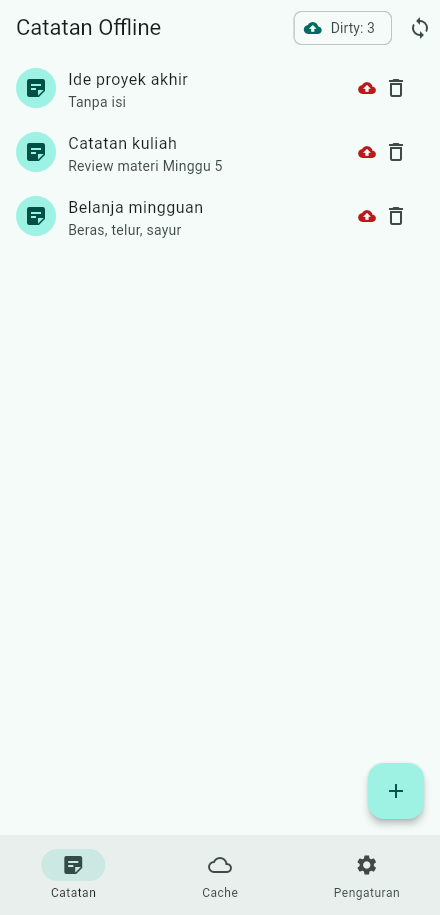
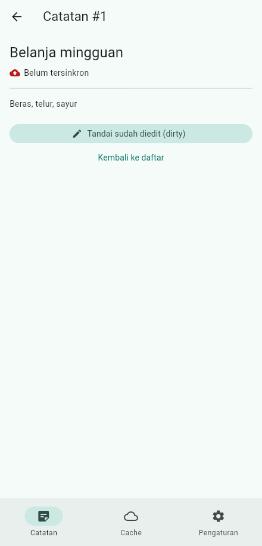
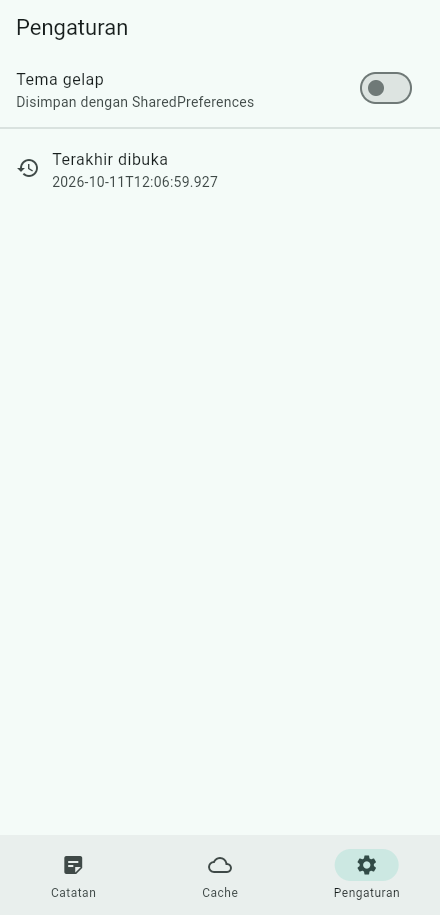
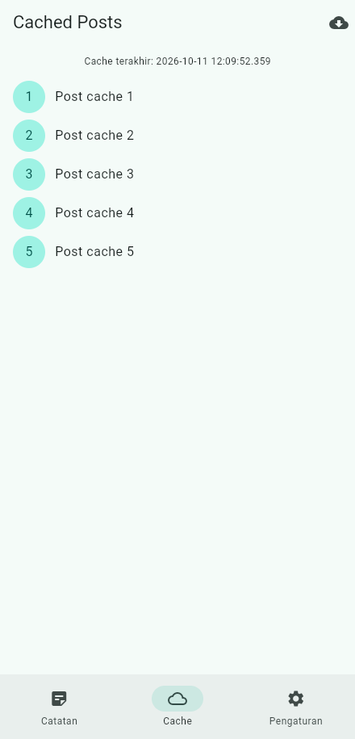
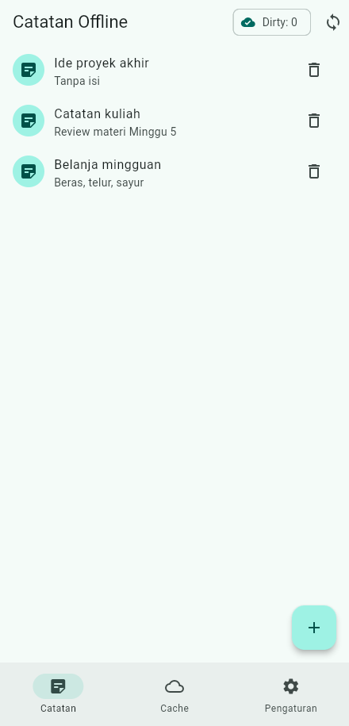
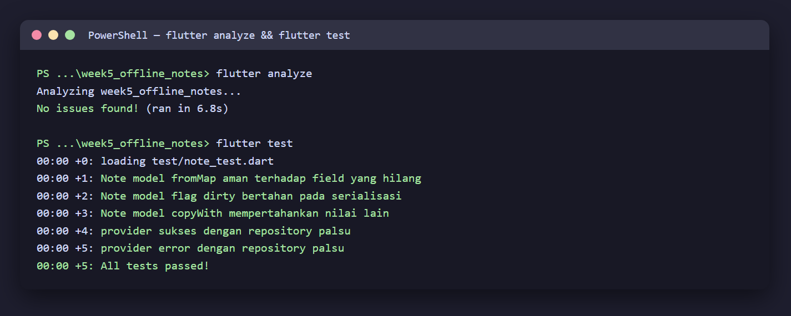

# 05 Week 5 — Local Storage & Offline-First

Dokumentasi hasil pengerjaan Praktikum Pemrograman Mobile Minggu ke-5. Dokumentasi ini berisi screenshot, penjelasan, dan jawaban pertanyaan dari praktikum.

**Identitas:** Adytria Bayu Ramadani · NIM 254107023004 · D4 Teknik Informatika · Jurusan Teknologi Informasi · Politeknik Negeri Malang

## Tujuan Pembelajaran

- Menjelaskan perbedaan penyimpanan key-value, relasional, dan NoSQL di perangkat.
- Menyimpan preferensi sederhana dengan `SharedPreferences`.
- Menerapkan CRUD catatan dengan SQLite (`sqflite`) melalui repository lokal.
- Menerapkan pola offline-first: cache-first read, dirty flag, dan antrean sinkronisasi.
- Menampilkan state loading, error, empty, success untuk data lokal dengan Riverpod.
- Menguji repository lokal dengan repository palsu.

## Struktur Folder

```
05-week-5-local-storage-offline-first/
├── week5_offline_notes/
│   ├── lib/
│   │   ├── main.dart                     # ProviderScope + sqflite web factory + theme
│   │   ├── router.dart                   # GoRouter (Catatan / Cache / Pengaturan)
│   │   ├── data/
│   │   │   ├── local/{note,db}.dart       # model + pembuka database
│   │   │   ├── prefs.dart                 # PrefsRepository (SharedPreferences)
│   │   │   ├── providers.dart             # NotesNotifier, dirty, sync, dark mode
│   │   │   ├── sync.dart                  # syncNotes (dirty -> markAllSynced)
│   │   │   └── repositories/
│   │   │       ├── note_repository.dart
│   │   │       └── post_cache_repository.dart
│   │   ├── pages/
│   │   │   ├── notes_page.dart            # CRUD + badge dirty + tombol sync
│   │   │   ├── note_detail_page.dart      # /note/:id dari repository lokal
│   │   │   ├── cached_posts_page.dart     # cache-first read
│   │   │   └── settings_page.dart         # tema + terakhir dibuka
│   │   └── widgets/note_tile.dart         # baris catatan + badge dirty
│   ├── test/note_test.dart                # 5 test
│   └── docs/ai-challenge.md               # tabel perbandingan storage
├── screenshots/
└── README.md
```

## Praktikum — Offline Notes

Catatan disimpan di SQLite melalui `NoteRepository` + Riverpod. Aplikasi
berfungsi penuh tanpa internet: baca, tambah, hapus. Badge **Dirty** di AppBar
menunjukkan jumlah catatan yang belum tersinkron.



Tambah catatan (judul + isi):



Detail catatan `/note/:id` membaca langsung dari repository lokal dan
menampilkan status dirty:


## Preferensi (SharedPreferences)

Toggle tema gelap + waktu terakhir dibuka, terpusat di `PrefsRepository`:



## Offline-First

### 1. Cache-first read

Tampilkan cache lokal seketika, refresh dari jaringan di background lalu simpan.
Tabel `cached_posts` menyimpan payload + `cached_at`:



### 2. Dirty flag + sinkronisasi

Setiap perubahan lokal ditandai `dirty = 1`. `syncNotes` mengirim catatan dirty
ke "server" (disimulasikan), lalu menandai bersih **hanya setelah sukses**:

**Sebelum sync (Dirty: 3):**


**Sesudah sync (Dirty: 0):**



**Aturan konflik:** *last-write-wins* berdasarkan `updated_at`.

## Checklist Verifikasi

- UI tidak memanggil SQLite/SharedPreferences langsung; semua lewat repository + provider.
- Aplikasi penuh berfungsi dalam mode pesawat: baca, tambah, hapus catatan.
- Badge dirty akurat sebelum/sesudah sync; cache posts tampil tanpa internet.
- `flutter analyze` tanpa issue dan semua test lulus.
- Hasil AI diverifikasi dan didokumentasikan pada folder `docs/`.

## Testing

```bash
flutter analyze   # No issues found!
flutter test      # 5 test lulus
```



| Test | Cakupan |
|---|---|
| fromMap aman field hilang | `{'title': 'Belanja'}` |
| flag dirty bertahan pada serialisasi | `toMap` → `fromMap` |
| copyWith mempertahankan nilai lain | id/title/dirty |
| provider sukses | repository palsu |
| provider error | `Exception` → `AsyncError` |

## Refactoring yang Dilakukan

1. Baris catatan diekstrak menjadi `NoteTile` yang menampilkan badge "belum tersinkron" bila `dirty`.
2. Logika cache posts dan `syncNotes` dipindah ke `lib/data/sync.dart` / repository terpisah agar `NoteRepository` fokus pada CRUD.
3. Halaman detail `/note/:id` dengan GoRouter membaca dari repository lokal, bukan dari state halaman list.

## AI Challenge

Prompt, tabel perbandingan SharedPreferences/Hive/SQLite/Drift, skema tabel, dan
checklist verifikasi ada di [`week5_offline_notes/docs/ai-challenge.md`](./week5_offline_notes/docs/ai-challenge.md).

---

## Kendala

sqflite tidak berjalan di web secara default. Untuk keperluan screenshot tanpa
emulator, ditambahkan `sqflite_common_ffi_web` (`databaseFactory = databaseFactoryFfiWeb`)
beserta header COOP/COEP pada server statis. Aplikasi target Android tetap
memakai sqflite biasa tanpa perubahan kode.

---

## Refleksi

1. Mengapa daftar catatan tidak boleh disimpan di `SharedPreferences`?

   Jawab: SharedPreferences hanya untuk nilai primitif kecil. Menyimpan koleksi catatan sebagai satu string JSON membuat query, update parsial, pengurutan, dan sinkronisasi rapuh serta lambat. Data koleksi harus masuk database (SQLite).

2. Kapan cache-first cukup, dan kapan butuh strategi lain (mis. network-first)?

   Jawab: Cache-first cocok untuk data yang jarang berubah dan lebih penting tersedia cepat/offline (catatan, daftar bacaan). Network-first dibutuhkan untuk data yang harus selalu terbaru (harga saham, status pembayaran) di mana data lokal hanya fallback.

3. Bagaimana dirty flag berubah menjadi antrean sync tanpa memblokir UI?

   Jawab: Setiap mutasi lokal menandai `dirty = 1` dan langsung memperbarui UI dari database lokal (tidak menunggu jaringan). Sinkronisasi berjalan di latar belakang dan menandai bersih setelah server sukses, sehingga UI tetap responsif.

4. Bagian mana dari rekomendasi AI yang Anda tolak, dan mengapa?

   Jawab: Tidak ada yang ditolak secara prinsip; namun klaim reaktivitas Hive/Drift tidak relevan di sini karena sqflite tidak punya stream, sehingga ditambahkan `ref.invalidate` manual setelah mutasi. Detail di `docs/ai-challenge.md`.

## Cara Menjalankan

```bash
cd week5_offline_notes
flutter pub get
flutter run -d edge     # atau -d chrome / perangkat Android
flutter test
```

> Catatan web: jalankan dengan `dart run sqflite_common_ffi_web:setup` sekali,
> dan serve dengan header COOP/COEP bila diperlukan.
