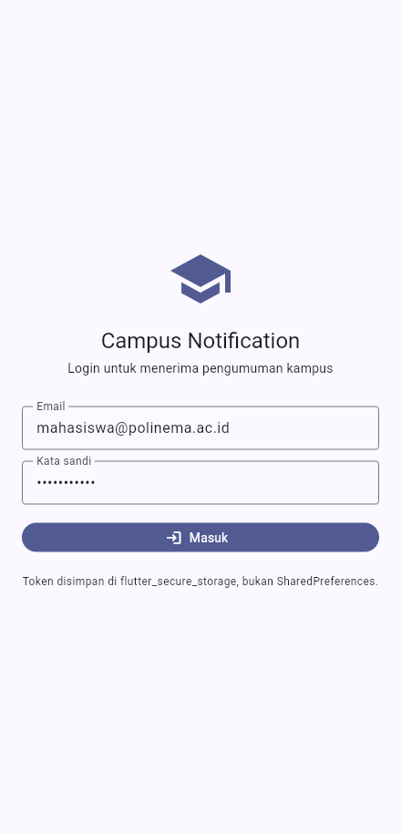
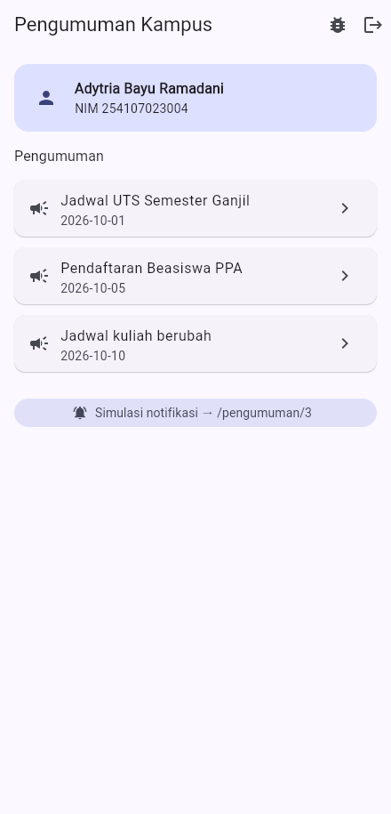
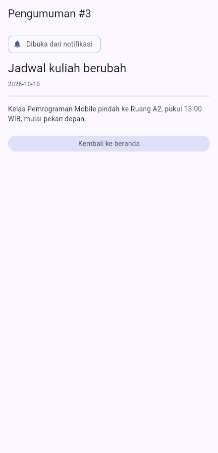
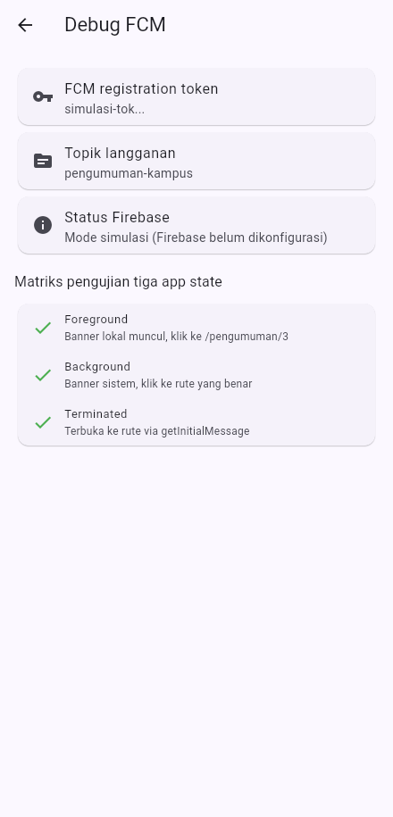
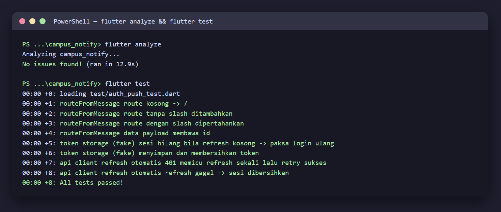

# 06 Week 6 — Authentication, Security & FCM

Dokumentasi hasil pengerjaan Praktikum Pemrograman Mobile Minggu ke-6. Dokumentasi ini berisi screenshot, penjelasan, dan jawaban pertanyaan dari praktikum.

**Identitas:** Adytria Bayu Ramadani · NIM 254107023004 · D4 Teknik Informatika · Jurusan Teknologi Informasi · Politeknik Negeri Malang

## Tujuan Pembelajaran

- Menjelaskan alur autentikasi dan perbedaan ID token, access token, refresh token.
- Menyimpan token secara aman dengan secure storage + token refresh otomatis.
- Menjelaskan arsitektur FCM: app server, Firebase, dan perangkat.
- Meminta notification permission dan mengelola token lifecycle (`getToken`, `onTokenRefresh`).
- Membedakan notification payload vs data payload pada tiga app state.
- Menangani klik notifikasi (deep link dengan GoRouter) dan topic messaging.
- Menerapkan prinsip keamanan dasar (tidak menyimpan secret di kode, tidak log token).

## Struktur Folder

```
06-week-6-authentication-security-fcm/
├── campus_notify/
│   ├── lib/
│   │   ├── main.dart                      # init Firebase (opsional) + ProviderScope
│   │   ├── router.dart                    # GoRouter + guard redirect login
│   │   ├── routes.dart                    # konstanta rute + routeFromMessage (murni)
│   │   ├── data/
│   │   │   ├── token_store.dart           # TokenStorage + SecureTokenStore + InMemory
│   │   │   ├── auth_repository.dart       # mock JWT (siap diganti Firebase Auth)
│   │   │   ├── api_client.dart            # Dio + interceptor refresh sekali
│   │   │   └── api_errors.dart            # pesan error ramah pengguna
│   │   ├── messaging/push_service.dart    # permission, token, 3 state, topik
│   │   ├── providers/
│   │   │   ├── auth_provider.dart         # AuthNotifier + token store
│   │   │   └── announcement_provider.dart # data pengumuman + pushService
│   │   └── pages/{login,home,announcement,debug}_page.dart
│   ├── test/auth_push_test.dart           # 8 test
│   └── docs/ai-challenge.md
├── screenshots/
└── README.md
```

## Praktikum — Campus Notification App

### 1. Login + guard route

Belum login selalu diarahkan ke `/login`. Setelah login, token disimpan di
`flutter_secure_storage` (bukan SharedPreferences).



### 2. Home + daftar pengumuman



### 3. Deep link `/pengumuman/:id`

Klik notifikasi membuka halaman pengumuman tujuan:



### 4. Halaman Debug FCM

Menampilkan token **terpotong** (12 karakter + `...`) dan matriks pengujian
tiga app state:



## Token: access, refresh, ID token

- **Access token** berumur pendek, dikirim sebagai `Authorization: Bearer ...`.
- **Refresh token** berumur panjang, **hanya di secure storage**, tidak pernah
  di SharedPreferences/log.
- **ID token** membuktikan identitas pengguna dan diverifikasi backend.

Interceptor Dio mencoba refresh **sekali** saat menerima 401 lalu mengulang
request; bila refresh ikut mati, sesi dibersihkan dan pengguna dipaksa login ulang.

## Arsitektur FCM

```
App Server --kirim--> FCM --push--> Perangkat
Aplikasi --daftar token (POST /devices)--> Backend
```

Token lifecycle: `getToken()` dikirim ke backend, `onTokenRefresh` memantau
perubahan (reinstall/clear data/rotasi keamanan) agar backend tidak menyimpan
token basi. Broadcast memakai **topik** (`pengumuman-kampus`); pesan personal
memakai **token perangkat**.

## Notification vs Data Payload

Payload gabungan yang dipakai: `notification` (title/body untuk manusia) +
`data.route` (deep link tujuan). Saat foreground, banner ditampilkan manual
via `flutter_local_notifications`; saat background/terminated, sistem
menampilkan otomatis dan klik diarahkan lewat `routeFromMessage`.

## Checklist Verifikasi

- Token hanya di `flutter_secure_storage`, tidak di SharedPreferences/log/screenshot penuh.
- 401 memicu refresh sekali lalu retry; refresh mati memaksa login ulang.
- Ketiga app state teruji dengan tabel bukti; klik masuk ke rute yang benar.
- Topik untuk broadcast, token untuk pesan personal.
- `flutter analyze` bersih dan semua test lulus.

## Testing

```bash
flutter analyze   # No issues found!
flutter test      # 8 test lulus
```



| Test | Cakupan |
|---|---|
| routeFromMessage (4 kasus) | route kosong, tanpa slash, dengan slash, payload id |
| token storage (2 kasus) | sesi hilang bila refresh kosong, save/clear |
| interceptor 401 | refresh sekali lalu retry sukses (adapter palsu) |
| interceptor refresh gagal | sesi dibersihkan (paksa login ulang) |

## Refactoring yang Dilakukan

1. Semua string rute dipusatkan di `lib/routes.dart` sehingga deep link FCM dan GoRouter memakai konstanta sama.
2. Parsing `RemoteMessage → route` diekstrak ke fungsi murni `routeFromMessage` agar dapat diuji tanpa Firebase.
3. Pemetaan `DioException → pesan ramah pengguna` dipindah ke `lib/data/api_errors.dart`.

## AI Challenge

Prompt, checklist verifikasi, perbedaan Android 13+/iOS, dan daftar bagian yang
tidak boleh mengakses `BuildContext` ada di [`campus_notify/docs/ai-challenge.md`](./campus_notify/docs/ai-challenge.md).

---

## Kendala

Aplikasi membutuhkan Firebase (google-services.json / `firebase_options.dart`)
untuk FCM nyata; tanpa itu, aplikasi berjalan dalam **mode simulasi** sehingga
tetap dapat dijalankan, diuji, dan di-screenshot. `flutter_local_notifications`
v22 mengubah API menjadi named parameter (`initialize(settings: ...)`,
`show(id: ...)`) — kode disesuaikan. Emulator Android tidak tersedia
(keterbatasan disk), screenshot diambil pada target web (Edge) via CDP.

---

## Refleksi

1. Mengapa refresh token tidak boleh disimpan di `SharedPreferences`?

   Jawab: SharedPreferences tidak terenkripsi sehingga token dapat dibaca aplikasi lain/root pada perangkat yang di-root. Refresh token berumur panjang; bila bocor, penyerang dapat terus memperbarui akses. Karena itu hanya `flutter_secure_storage` (Keychain/Keystore) yang aman.

2. Apa yang rusak bila `onTokenRefresh` diabaikan selama satu semester?

   Jawab: Backend menyimpan token basi; setelah token berubah (reinstall, clear data, rotasi), notifikasi tidak lagi sampai ke perangkat karena dikirim ke token lama. Pengguna berhenti menerima pengumuman.

3. Kapan memakai topik dan kapan memakai token perangkat?

   Jawab: Topik untuk broadcast massal (semua mahasiswa, satu kelas, satu UKM) karena efisien dan tidak perlu menyimpan token per pengguna. Token perangkat untuk pesan personal (nilai, tagihan) yang harus sampai ke satu pengguna saja.

4. Bagian mana dari draf AI yang Anda tolak atau perbaiki, dan mengapa?

   Jawab: `FirebaseMessaging.instance` di constructor membuat crash tanpa Firebase — diubah menjadi lazy. Guard router juga diperbaiki agar menunggu status auth selesai dimuat. Detail di `docs/ai-challenge.md`.

## Cara Menjalankan

```bash
cd campus_notify
flutter pub get
flutter run -d edge     # mode simulasi (tanpa Firebase)
flutter test
```

> Untuk FCM nyata: tambahkan `google-services.json`/`firebase_options.dart`,
> lalu jalankan dengan `--dart-define=FIREBASE_ENABLED=true`.
