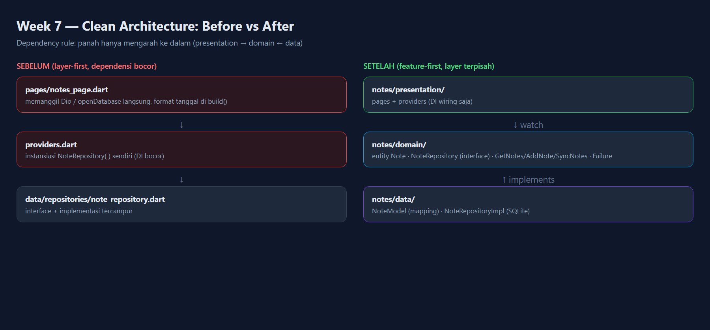
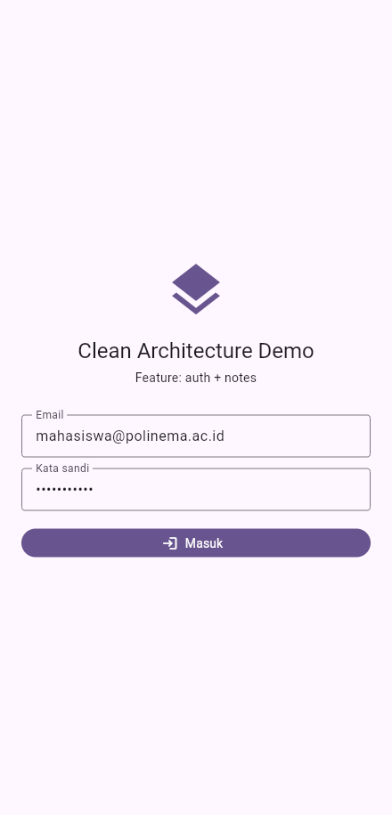
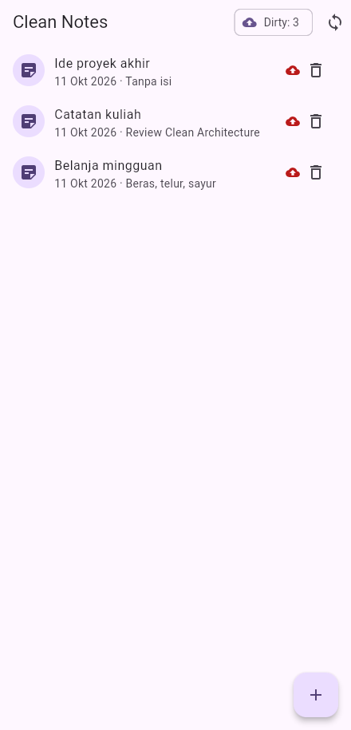
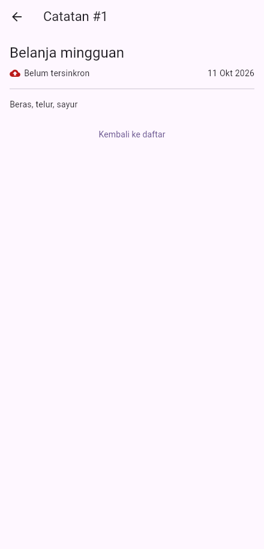
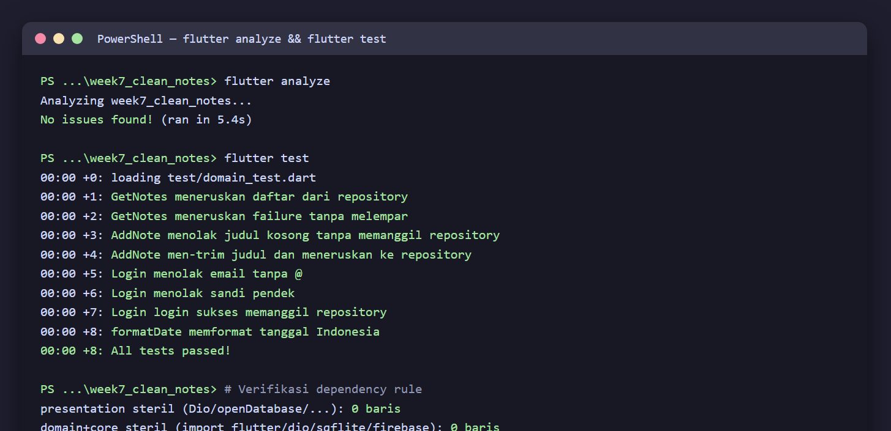

# 07 Week 7 — Clean Architecture

Dokumentasi hasil pengerjaan Praktikum Pemrograman Mobile Minggu ke-7. Dokumentasi ini berisi screenshot, penjelasan, dan jawaban pertanyaan dari praktikum.

**Identitas:** Adytria Bayu Ramadani · NIM 254107023004 · D4 Teknik Informatika · Jurusan Teknologi Informasi · Politeknik Negeri Malang

## Tujuan Pembelajaran

- Menjelaskan prinsip SOLID dan separation of concerns dengan contoh kode Flutter.
- Membedakan struktur feature-first vs layer-first beserta trade-off-nya.
- Menjelaskan tiga layer (presentation, domain, data) dan aturan dependensi.
- Membedakan entity vs model serta peran repository, use case, dan dependency injection.
- Merefactor project menjadi struktur feature-first terpisah layer.
- Menguji use case dengan repository palsu tanpa database/jaringan sungguhan.

## Struktur Folder (feature-first)

```
07-week-7-clean-architecture/
├── week7_clean_notes/
│   ├── lib/
│   │   ├── main.dart                       # ProviderScope + MaterialApp.router
│   │   ├── router.dart                     # GoRouter + guard login
│   │   ├── core/
│   │   │   ├── failures.dart               # Failure domain (murni Dart)
│   │   │   └── format.dart                 # fungsi murni formatDate
│   │   └── features/
│   │       ├── notes/
│   │       │   ├── domain/
│   │       │   │   ├── entities/note.dart              # entity murni
│   │       │   │   ├── repositories/note_repository.dart  # interface!
│   │       │   │   └── usecases/{get_notes,add_note,sync_notes}.dart
│   │       │   ├── data/
│   │       │   │   ├── models/note_model.dart          # mapping
│   │       │   │   ├── datasources/notes_db.dart
│   │       │   │   └── repositories/note_repository_impl.dart
│   │       │   └── presentation/
│   │       │       ├── providers/notes_providers.dart  # DI wiring
│   │       │       └── pages/{notes_page,note_detail_page}.dart
│   │       └── auth/
│   │           ├── domain/{entities/session,repositories/auth_repository,usecases/login}.dart
│   │           ├── data/repositories/auth_repository_impl.dart
│   │           └── presentation/{providers/auth_providers,pages/login_page}.dart
│   ├── test/domain_test.dart               # 8 test
│   └── docs/ai-challenge.md
├── screenshots/
└── README.md
```

## Arah Dependensi

```
presentation (widget, notifier, router)
      |
      v  bergantung ke
domain (entity, repository interface, use case, failure)
      ^
      |  diimplementasikan oleh
data (model, repository impl, SQLite)
```

**Dependency rule:** dependensi hanya mengarah ke dalam. `domain` tidak tahu
apa pun tentang Flutter, Dio, atau SQLite.



## Praktikum — Refactor ke Clean Architecture

### Login (fitur auth)



### Daftar catatan (fitur notes)

`NotesPage` hanya membaca provider; tidak ada SQL, JSON, atau formatting mentah.



### Detail catatan `/note/:id`



## Verifikasi Dependency Rule

```bash
# 1. Presentation steril dari data mentah -> harus NOL
grep -E "Dio\(|openDatabase|getDatabasesPath|FlutterSecureStorage|SharedPreferences\.getInstance|jsonDecode" lib/features/*/presentation

# 2. Domain + core steril dari framework -> harus NOL
grep -E "import 'package:flutter|import 'package:dio|import 'package:sqflite|import 'package:firebase" lib/features/*/domain lib/core

# 3. Static analysis + test
flutter analyze
flutter test
```

**Hasil:** grep #1 = **0 baris**, grep #2 = **0 baris**, `flutter analyze` bersih,
8 test lulus.

## Checklist Verifikasi

- Tiga grep sterilitas (presentation & domain) nol hasil.
- Interface di domain, implementasi di data, mapping hanya di model.
- Widget tidak menginstansiasi repository; semua lewat provider.
- Aplikasi berjalan identik sebelum/sesudah refactor (bukti screenshot).
- `flutter analyze` bersih dan semua test lulus.

## Testing

```bash
flutter analyze   # No issues found!
flutter test      # 8 test lulus
```



| Test | Cakupan |
|---|---|
| GetNotes sukses | meneruskan daftar dari repository palsu |
| GetNotes failure | failure diteruskan tanpa melempar |
| AddNote judul kosong | ditolak tanpa memanggil repository (aturan bisnis) |
| AddNote trim | judul di-trim lalu diteruskan |
| Login validasi (2 kasus) | email tanpa `@`, sandi < 6 karakter |
| Login sukses | memanggil repository |
| formatDate | fungsi murni tanggal Indonesia |

## Refactoring yang Dilakukan

1. Fitur kedua (auth) dipecah dengan pola sama: entity + repository interface + impl + use case + provider wiring.
2. `formatDate` diekstrak ke `lib/core/format.dart` sebagai fungsi murni yang dapat diuji tanpa widget.
3. Semua exception mentah diubah menjadi `Failure` yang ramah pengguna sebelum mencapai UI; UI hanya menerima `message`.

## AI Challenge

Prompt, tabel usulan-vs-keputusan-final, dan hasil tiga grep ada di
[`week7_clean_notes/docs/ai-challenge.md`](./week7_clean_notes/docs/ai-challenge.md).
Poin penting: use case per CRUD satu-baris **ditolak** (over-engineering);
use case hanya dibuat untuk operasi dengan aturan bisnis (`AddNote`, `SyncNotes`).

---

## Kendala

Emulator Android tidak tersedia (keterbatasan disk), sehingga aplikasi
dijalankan pada target web (Edge) via CDP. sqflite di web memakai
`sqflite_common_ffi_web` + header COOP/COEP.

---

## Refleksi

1. Mengapa interface repository harus tinggal di domain, bukan di data?

   Jawab: Karena domain yang mendefinisikan kebutuhannya, sedangkan data yang menyesuaikan. Bila interface ditaruh di data, domain harus mengimpor data sehingga arah dependensi terbalik (domain bergantung pada SQLite/Dio) dan logika bisnis tidak lagi dapat diuji murni.

2. Kapan use case benar-benar dibutuhkan, dan kapan repository langsung ke notifier sudah cukup?

   Jawab: Use case dibutuhkan saat ada aturan bisnis (validasi, sorting, konflik) atau operasi menggabungkan beberapa repository. CRUD satu-baris tanpa aturan cukup diteruskan repository langsung ke notifier.

3. Apa biaya over-engineering (use case per CRUD satu-baris) bagi tim kecil?

   Jawab: Menambah banyak file boilerplate tanpa nilai, memperlambat perubahan, dan menyulitkan navigasi kode. Biaya ini sepadan hanya untuk fitur kompleks dengan banyak aturan bisnis.

4. Bagian mana dari usulan AI yang Anda tolak atau sederhanakan, dan mengapa?

   Jawab: Usulan membuat use case untuk semua operasi CRUD ditolak; hanya `AddNote` (validasi) dan `SyncNotes` (gabungan operasi) yang dibuat. Detail di `docs/ai-challenge.md`.

## Cara Menjalankan

```bash
cd week7_clean_notes
flutter pub get
flutter run -d edge     # atau -d chrome / perangkat Android
flutter test
```
